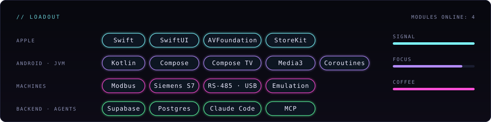

<p align="center">
  
</p>

```text
> whoami
  cenk gün · independent software engineer · istanbul

> cat ./focus
  native apps for every screen in the house: phone, tablet, mac, tv
  software that talks to real machines: industrial protocols, live sensors, closed loops
  emulators, so a machine can be tested before it is in the room
  agentic engineering: shipping with ai agents as the build crew, not the autocomplete

> uptime --mode
  building. shipping. calibrating.
```

<p align="center">
  
</p>

### `// open signals`

| | |
|---|---|
| [**design-award-lens**](https://github.com/cenkgundev/design-award-lens) | A Claude Code skill that finds AI slop in Apple-platform app design and fixes it, measured against what Apple Design Award winners actually do. |

### `// protocol`

```text
build the real thing, then a twin to break it on
fewer words on screen, more meaning per pixel
if it ships on monday, it gets tested on sunday
```

<p align="center">
  <sub><code>SYS://CENKGUNDEV</code> · transmission ends · <code>EOF</code></sub>
</p>
